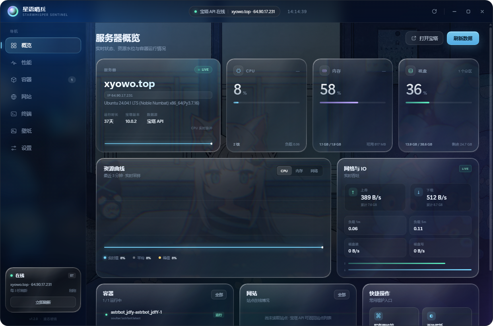
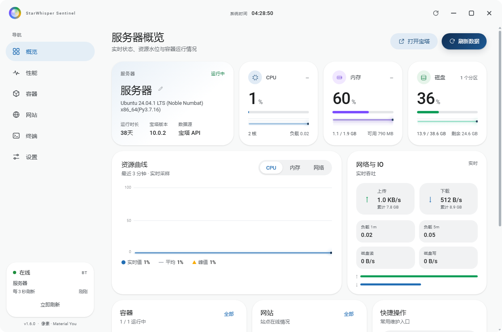
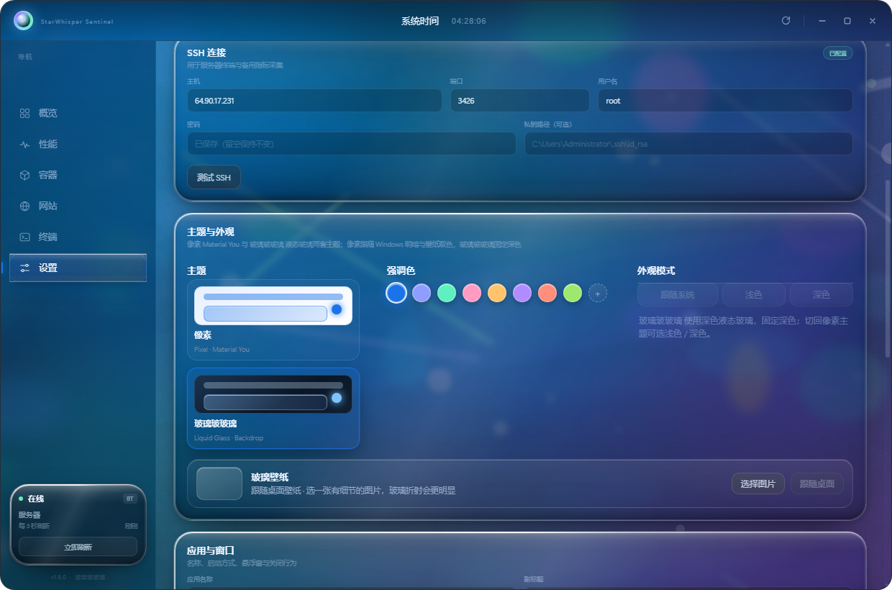
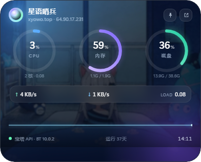
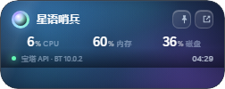
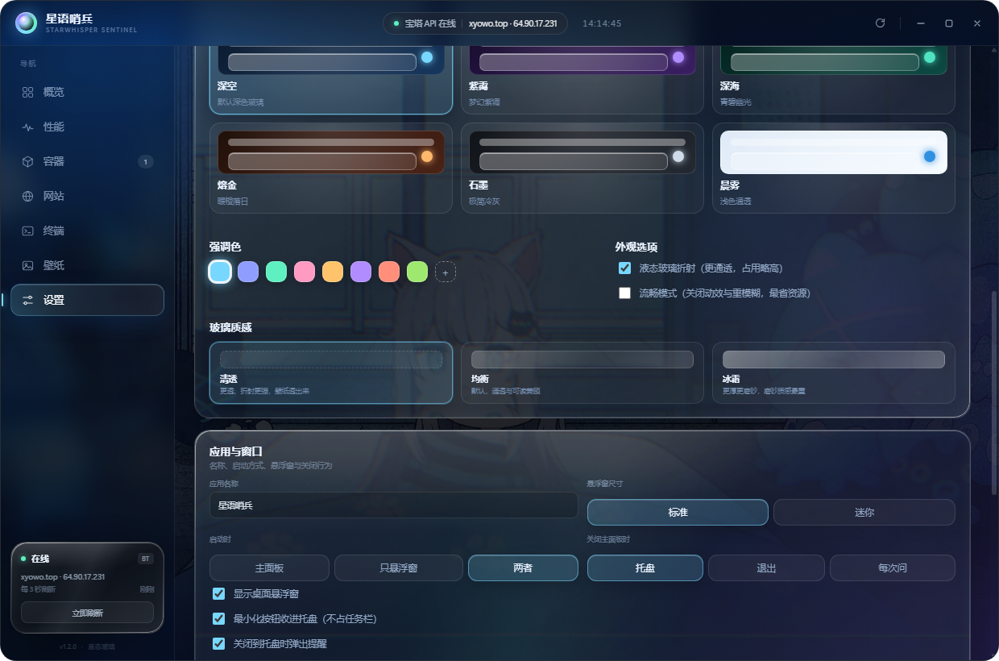
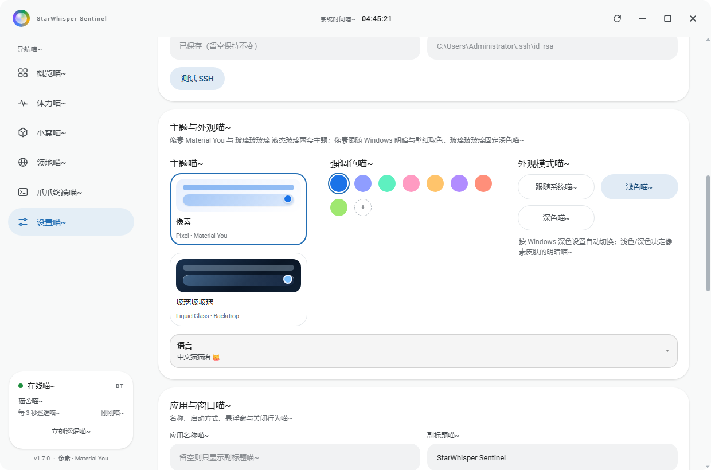

# 服务器监控工具 · StarWhisper Sentinel（星语哨兵）

一个 Windows 桌面的服务器监控小工具：桌面悬浮窗 + 像素（Material You）／玻璃玻玻璃（液态玻璃）两套主面板 + 内嵌终端，界面可切换**简体中文 / 中文猫猫语**。
数据优先走**宝塔面板 API**，其次 SSH，没配置时进入**演示模式**，开箱即可看到完整效果。









> 作者：DeepSeek Harness Agent（AI 编程助手，DeepSeek Harness）
> 许可：MIT（见 [LICENSE](LICENSE)）

## 功能

- **桌面悬浮窗**：无边框、置顶、可拖动，实时显示 CPU / 内存 / 磁盘圆环、上下行速率、CPU 脉冲与运行时长；单击/双击展开主面板。两种尺寸：**标准**（392×316 圆环版）与**迷你**（252×100 一行数字版，适合塞在屏幕角落）。
- **两套主面板皮肤（v1.6）**：概览、性能、容器、网站、终端、设置六个页面 + 悬浮窗一起换肤。**像素**（Pixel · Material You：实色 M3 卡片、28px 大圆角、壁纸动态取色、明暗跟随系统）与 **玻璃玻玻璃**（深色液态玻璃：SDF 位移贴图折射、镜面倒角、壁纸透出）。
- **宝塔 API 直连**：用面板 API 密钥（双重 MD5 签名）拉取系统负载、磁盘、网络、IO、Docker 容器等，无需开放 SSH。
- **SSH 备用通道**：内置 ssh2，指标采集 + xterm.js 交互终端；密码或私钥登录。
- **服务器终端**：主面板内嵌完整终端；也可一键在浏览器打开宝塔「终端」页。
- **壁纸底色**：读取当前桌面壁纸作为面板与悬浮窗的背景，像素主题会从壁纸采样主色、玻璃玻玻璃把壁纸压暗后透出；玻璃玻玻璃还可以单独换一张壁纸（设置 → 主题与外观 → 玻璃壁纸）。v1.5 起移除壁纸管理页（不再提供图库与显示方式）。
- **主题与配色**：像素（Pixel · Material You）与 玻璃玻玻璃（Liquid Glass）两套主题 + 9 个强调色 + 自定义取色，主面板与悬浮窗同步；像素可选跟随系统 / 浅色 / 深色，玻璃玻玻璃固定深色。v1.5 起移除了深空 / 紫霭 / 深海 / 熔金 / 石墨 / 晨雾六套旧主题，以及「外观选项」（液态玻璃、流畅模式）和「玻璃质感」三档。
- **语言：简体中文 / 中文猫猫语（v1.7）**：设置 → 主题与外观 → 语言（默认折叠成一行），点开切换后整套界面文案、提示、托盘菜单即时喵化（句尾「喵~」、猫舍 / 爪爪终端 / 铲屎官 / 发光小方块等名词替换）；选择会记住并同步到悬浮窗，切回简体中文即完全恢复。
- **IP / 域名隐私开关**：设置页可分别关闭「显示服务器 IP」「显示域名」；关闭后标题栏、概览卡片与悬浮窗自动隐藏对应信息（只留一个，或都隐藏显示「服务器」）。
- **应用与窗口（v1.2 / v1.4 / v1.6）**：设置页可改**应用名称与副标题**（标题栏、托盘、悬浮窗、关于同步更换；名称可留空，副标题留空则隐藏）、选**启动方式**（主面板 / 只悬浮窗 / 两者）、开关**悬浮窗显示**；**最小化按钮收进任务栏**（v1.6 起改为正常最小化，不再默认收进托盘，可从任务栏或托盘恢复）。
- **关闭行为可控（v1.2）**：关闭主面板可选「最小化到托盘 / 直接退出 / 每次询问」；可设置关到托盘时弹**提醒**（内容可选托盘 / 悬浮窗 / 退出，或自定义文案），另有「不再提醒」；也有「关闭并退出程序」按钮。
- **设置全部加密（v1.3）**：所有用户输入（面板地址、API 密钥、SSH 主机/端口/账号/密码/私钥路径等）整体序列化后加密写入 `settings.json` —— 优先 Windows DPAPI（safeStorage），系统不支持时退到 AES-256-GCM + 本地随机密钥；磁盘与仓库里都不存在明文，并用 `icacls` 把设置文件与密钥文件限制为当前用户可读。
- **托盘常驻**：托盘菜单可打开主面板、显示/隐藏悬浮窗、切换悬浮窗尺寸（标准/迷你）、立即刷新、打开设置、退出。

## 下载

免安装：到 [Releases](https://github.com/furxingyu-star/server-monitor-tool/releases) 下载 `star-sentinel-v1.7.1-win32-x64.zip`，解压后运行 `StarSentinel.exe`。
首次启动是演示模式，到 **设置** 里填宝塔 API 或 SSH 就能接上你自己的服务器。

## 快速开始

```powershell
# 开发模式
pnpm install
pnpm start

# 打包（默认生成 dist\StarSentinel-win32-x64\StarSentinel.exe，可用 SENTINEL_OUT_DIR=release 换目录）
pnpm pack
```

首次启动进入「演示模式」，看到的是模拟数据；到 **设置** 切换数据源。

### 1. 宝塔 API（推荐）

1. 宝塔面板 → 设置 → API 接口 → 开启并复制 **API 密钥**（api_sk）。
2. 确认面板地址可从本机访问，例如 `https://1.2.3.4:8888` 或你的域名 + 安全入口。
3. 应用内 **设置 → 宝塔 API**：填面板地址、API 密钥；若面板是自签证书，勾选「允许自签证书」。
4. 点「测试连接」，成功后保存，模式切到 **BT**。

> 需要的接口权限：`/system`（GetSystemTotal、GetDiskInfo、GetLoadAverage、GetNetWork、GetCpuInfo、get_io_info）、`/btdocker/container/get_list`。
> 若面板开启了 API IP 白名单，请把本机公网出口 IP 加进去，否则请求会被面板返回 404。

### 2. SSH（终端与备用指标）

设置 → SSH：主机、端口、用户名、密码或私钥路径。保存后模式切到 **SSH**。
终端页点「立即连接」即可交互；宝塔 API 模式也能单独用 SSH 终端（API 不提供命令执行接口）。

> 若服务器只开了宝塔端口、没开 22，可继续用宝塔 API 看监控，终端用「打开宝塔终端」跳转网页。

### 3. 主题与外观

设置页「主题与外观」三列并排：

- **主题**：两套皮肤，点卡片立即生效并记住（下次启动直接进上次的主题；首屏用 localStorage 回填，不会闪错皮肤）。
  - **像素 / Pixel · Material You**（`renderer/pixel-theme.css`）：实色表面卡片 28px 大圆角 + 两层 Material 阴影、胶囊按钮与分段控件、M3 复选框与开关、填充式输入框（聚焦蓝色描边 + 4px 光环）、深色 Snackbar、Roboto 字体（本地 `renderer/fonts/`）。
    - **动态取色**：从当前桌面壁纸采样主色，按 Material You 规则派生出 primary / primary-container / surface 一到三档 / on-surface / outline 整套色调；没换壁纸时也可用强调色当种子（点色点或自定义取色即可）。
    - **取色规则**：进入像素主题时默认从壁纸取色；在像素主题里点强调色圆点或自定义取色 = 用该颜色当种子；之后换壁纸会自动回到「从壁纸取色」。圆环、进度条、图表曲线都跟着主色走。
    - **深色只给刷新**：概览页「刷新数据」用深色（主色压暗）胶囊底 + 白字，是全页唯一的深色块；「打开宝塔」等其余操作一律 tonal / 文字按钮，不抢焦点。
    - **悬浮窗**：Material You 卡片（Google 四色 logo、蓝 / 紫 / 绿三色圆环、tonal 圆角图标按钮与网络条），壁纸只留一层淡淡色调。
  - **玻璃玻玻璃 / Liquid Glass（v1.6 新增）**（`renderer/glass-theme.css` + `renderer/glass.js`）：参考 [Kyant0/AndroidLiquidGlass](https://github.com/Kyant0/AndroidLiquidGlass) 的液态玻璃做法。
    - **折射**：`glass.js` 按卡片圆角与尺寸生成 SDF 位移贴图，经 `feDisplacementMap` 做「边缘透镜 + 中心微凸」的折射，再加三通道色散（轻微彩虹边），作为 `backdrop-filter` 的滤镜链作用在真实背景上——背后壁纸是流动的，边缘会被「拉弯」。
    - **材质**：深色蓝紫玻璃底 + 顶部径向反光 + 1px 镜面倒角环（遮罩挖空实现）+ 外投影与内高光；卡片内容浮在滤镜层之上，不被模糊。
    - **壁纸透出 + 可自选**：壁纸只压暗、提饱和，所有 `.glass` 面板都能看到背后的极光；导航胶囊、按钮、悬浮窗同步玻璃化。液态玻璃需要「有细节」的背景才看得出折射，所以设置 → 主题与外观 → 玻璃壁纸可以单独给玻璃主题换一张图（「选择图片」即时生效，主面板和悬浮窗一起换；「跟随桌面」恢复系统壁纸）。像素主题始终跟随桌面壁纸并据此取色。
    - **固定深色**：该主题只用深色液态玻璃，外观模式三档自动灰掉并提示「切回像素主题可选浅色 / 深色」。
- **强调色**：9 个色点 + 自定义取色器：控制圆环、曲线、按钮主色，也是像素主题 Material You 的取色种子。
- **外观模式（v1.4）**：跟随系统 / 浅色 / 深色三档，随 Windows 深色设置实时切换（不重启）；悬浮窗、图表曲线、M3 色调一起跟着换。玻璃玻玻璃主题下固定深色、此项禁用。
- **语言（v1.7）**：默认折叠成一行（「语言 · 当前语言 · ▾」），点开是「简体中文 / 中文猫猫语 🐱」两枚分段按钮，选中即时生效并持久化。
  - `renderer/cat-speak.js` 只给界面文案加猫味：句尾「喵~」、名词替换（服务器→猫舍、终端→爪爪终端、用户名→铲屎官名、容器→小窝、网站→领地、性能→体力、密码→爪印密码、密钥→小鱼干钥匙…）、适当 emoji；标题会加 🐾 / ⚡ / 📦 / 🌐 等。
  - **不翻译**：IP、端口、路径、密钥、终端输出、`<pre>/<code>`、输入框里的配置值原样保留；托盘菜单也会跟着喵化（退出 →「溜了溜了喵~」）。
  - 两套主题（像素 / 玻璃玻玻璃）与外观模式都不受影响，随时切回简体中文。
- **性能**：折射滤镜只在玻璃玻玻璃主题按需挂载（像素主题零开销），并遵循系统「减少动态效果」设置。

### 4. 应用与窗口（v1.2）

设置页「应用与窗口」：

- **应用名称**：标题栏、悬浮窗标题、托盘提示、任务栏标题一起改。
- **悬浮窗尺寸**：标准 / 迷你；也可从托盘菜单切换（右下角为锚点缩放）。
- **启动时**：打开主面板 / 只显示悬浮窗 / 两者都开。
- **关闭主面板时**：最小化到托盘 / 退出程序 / 每次询问（可勾选记住选择）。
- **提醒**：关到托盘时是否弹提醒、提醒内容（托盘 / 悬浮窗 / 退出 / 自定义文案）、「不再提醒」、以及「预览提醒」按钮。
- 悬浮窗四角做了真透明圆角裁剪（去掉了会露出方角的窗口阴影），白底壁纸下也不会露方形边。


设置页「显示与刷新」：

- **显示服务器 IP**：控制标题栏、概览 hero 的 IP 徽标、悬浮窗副标题是否出现服务器 IP（取自 SSH 主机，或宝塔面板地址的域名解析目标）。
- **显示域名**：控制是否显示服务器名称（留空时自动用宝塔面板域名 / SSH 主机名）。关闭后主标识改用 IP；两个都关则显示「服务器」。
- **服务器改名**：概览主机卡上名字右侧的铅笔（或双击名字）就地改名，回车保存；同名字段也在「显示与刷新」里。改名后主面板与悬浮窗同步，清空则恢复自动命名。
- 两个开关即时生效，同步到悬浮窗，并写入本地设置，下次启动沿用。

## 数据与隐私

- **全部设置整体加密**：面板地址、API 密钥、SSH 主机/账号/密码/私钥路径以及主题/外观/语言选项，先合并成一份 JSON，再用 Windows DPAPI（Electron `safeStorage`）加密成单个信封写入 `%APPDATA%\星语哨兵\settings.json`（`format: 3`）；系统没有 DPAPI 时自动改用 AES-256-GCM + 本机随机密钥 `store.key`，两者都用 `icacls` 限制为当前用户读。旧版本（≤1.2）的明文配置会在第一次启动时自动迁移并立即改写成密文。
- 运行期的明文只在内存里；界面回传设置时密钥与密码字段会被抹成空串（`hasApiKey` / `hasPassword` 标记代替），不会回流到渲染层日志或磁盘。
- 不上传任何服务器；仓库里的默认配置是空的（`mode: demo`），不含任何真实凭据、域名或 IP。
- 壁纸仅在本机读取（只读系统当前壁纸），不上传。

## 目录

```
electron/   主进程：main.js（窗口/托盘/IPC）、btapi.js、ssh.js、wallpaper.js、store.js、demo.js、preload.js
renderer/   index.html / app.css / app.js / pixel-theme.css（像素主题皮肤） / glass-theme.css（玻璃玻玻璃皮肤） / glass.js（液态玻璃折射） / cat-speak.js（中文猫猫语） / fonts/（Roboto） / widget.html / widget.js / widget.css
assets/     图标
scripts/    make-icon.py、pack.mjs、make-bundle.ps1（离线发版）、push-to-github.ps1
docs/screenshots/ 界面截图
```

## 发布与更新

在线仓库：<https://github.com/furxingyu-star/server-monitor-tool>

```powershell
# 推到 GitHub（默认 SSH，密钥 %USERPROFILE%\.ssh\star_sentinel2）
powershell -NoProfile -ExecutionPolicy Bypass -File scripts\push-to-github.ps1

# 可选：顺便生成完全离线的发布包
powershell -NoProfile -ExecutionPolicy Bypass -File scripts\make-bundle.ps1
```

- `push-to-github.ps1` 默认远端 `git@github.com:furxingyu-star/server-monitor-tool.git`；换仓库传 `-RepoUrl`，换密钥传 `-SshKey`。
- `make-bundle.ps1` 产出 `_publish\star-sentinel.bundle`（完整 git 历史，可 clone）与 `_publish\star-sentinel-src.zip`（源码，遵守 .gitignore），适合完全离线的机器。

## 已知限制

- 宝塔 API 没有命令执行接口，终端必须 SSH 或跳转面板网页。
- 网站列表接口未在文档中公开验证，BT 模式下站点卡片可能为空（不影响监控）。
- 自签证书需要勾选允许，或给面板配正经证书。
- 悬浮窗目前只在主显示器上按坐标保存位置（多屏切换后会自动回落到主屏右下角）。
